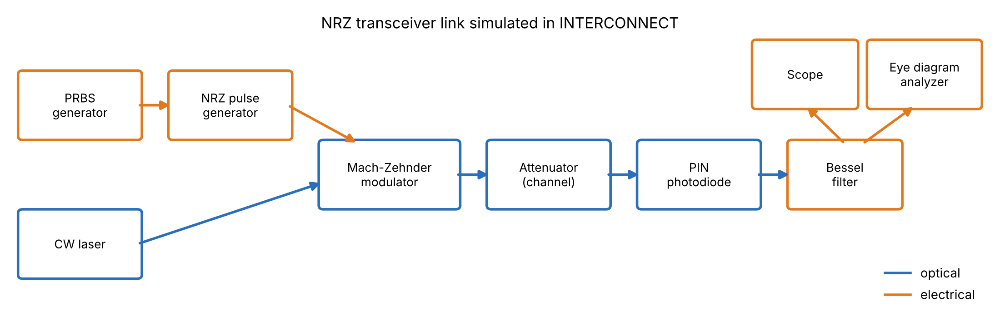
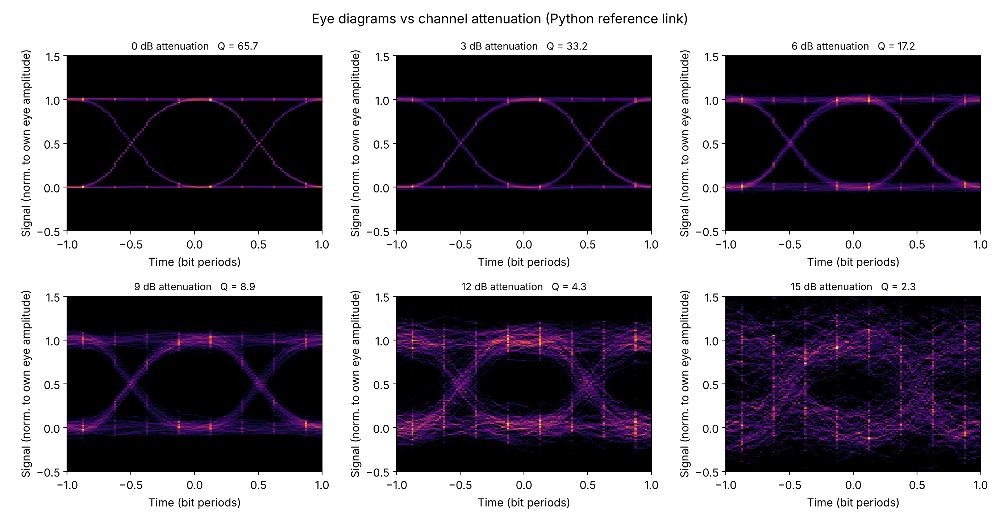
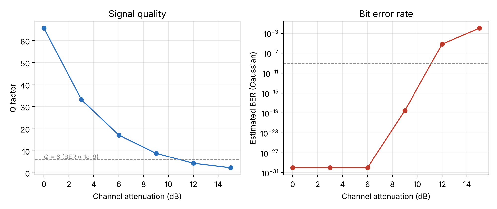

# NRZ Optical Transceiver Link in Ansys Lumerical INTERCONNECT

Time-domain simulation of an externally modulated 10 Gb/s NRZ optical link, built and run with **Ansys Lumerical INTERCONNECT** through `lumapi`, plus an analysis pipeline that turns the exported receiver waveforms into eye diagrams, Q factor and estimated BER versus channel loss.



## What is simulated

| Block | INTERCONNECT element | Role |
|---|---|---|
| Light source | CW Laser | 1550 nm, 1 mW |
| Data | PRBS Generator → NRZ Pulse Generator | 10 Gb/s pseudo-random NRZ drive |
| Transmitter | Mach-Zehnder Modulator | analytical two-arm model; 6 dB insertion loss, 20 dB extinction ratio |
| Channel | Optical Attenuator | swept from 0 to 15 dB |
| Receiver | PIN Photodetector → Low Pass Bessel Filter | shot and thermal noise, 0.75 × bit-rate cutoff |
| Probes | Oscilloscope, Eye Diagram Analyzer | waveform capture and in-tool eye view |

The Mach-Zehnder modulator drives each arm's phase as π(V/Vπ), and the output power depends on the phase difference between the arms. The NRZ swing is set equal to Vπ (4 V), so the modulator switches between full transmission and its extinction-limited minimum.

The data-flow simulator is sampled in time: with the bit rate, sequence length and samples per bit set, INTERCONNECT derives the time window and sample rate (here 512 bits × 64 samples per bit, i.e. a 640 GHz sample rate at 10 Gb/s).

## Workflow

```
lumerical/transceiver_interconnect.py   build the circuit, sweep the attenuation, export waveforms  ->  data/wave_att*.npz
analysis/eye_analysis.py                eye diagrams, Q factor, BER, waveforms                       ->  images/, data/metrics.json
```

The analysis does not depend on the analyzer's result names: it recomputes the eye, Q and BER from the exported oscilloscope waveform. It picks the best sampling instant on the cleanest run, takes that run's decisions as the reference bit pattern, and applies them to all other attenuations.

## Run

Requirements: Ansys Lumerical INTERCONNECT with the Python API, Python 3.8+, `numpy`, `scipy`, `matplotlib`.

```bash
pip install -r requirements.txt

cd lumerical
python transceiver_interconnect.py --hide        # options: --bitrate, --atten 0 3 6 9 12 15

cd ../analysis
python eye_analysis.py                           # figures -> ../images
```

If `lumapi` is not importable, set `LUMAPI_PATH` to Lumerical's `api/python` folder.

## Results

Generated into `images/` by `analysis/eye_analysis.py` from the INTERCONNECT waveforms:


## Python reference link

`reference_model/` is an independent Python model of the same link (PRBS-9, Gaussian-filtered NRZ edges, the same MZM phase equation, shot and thermal noise, 4th-order Bessel filter). It writes waveforms in the same format and runs the same analysis, which validated the analysis code and shows the behavior to expect from the Lumerical run. It is **not** an INTERCONNECT result.



With the illustrative parameters above, Q drops from about 66 at 0 dB to 8.9 at 9 dB, 4.3 at 12 dB and 2.3 at 15 dB, so the eye closes between roughly 9 and 12 dB of channel loss as thermal noise dominates.



## Limitations

- BER is a Gaussian estimate from Q, and 512 bits give limited statistics. Very low BER values are extrapolations; use a longer sequence for tighter numbers.
- The modulator is an analytical model with no bandwidth limit of its own; the finite edge speed comes from the NRZ generator and receiver filter.
- Property and result names can differ between INTERCONNECT versions. The script reports anything it could not set or read (`[warning] ...`). In particular, check the NRZ generator's amplitude/bias convention against the transmitter scope (`OSC_TX`, exported to `data/tx_drive.npz`) and pass `--result-name` if your oscilloscope's result is not called `signal`.
- Single wavelength, no fiber dispersion, no chirp, no receiver amplifier model beyond the photodiode noise.

## Acknowledgement

The link topology follows the Ansys Lumerical INTERCONNECT example *"Transceiver"*: https://optics.ansys.com/hc/en-us/articles/360042323634-Transceiver

The scripts, parameter choices, analysis, text and figures in this repository are my own.

## Author

Ripon Kumar Dey, PhD
